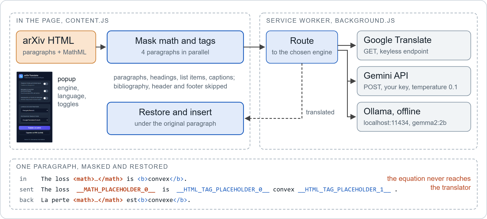

# arXiv Translate: translate arXiv HTML papers without touching the equations

[Install](#install) · [Privacy policy](PRIVACY_POLICY.md) · [Smoke-test log](docs/smoke_test_2026-11-03.json)

A Manifest V3 Chrome extension that translates arXiv HTML papers paragraph by paragraph into one of 8 languages. Equations are replaced by placeholders before the text leaves the page, so the MathML on screen is the one arXiv rendered. Three backends: Google Translate (no key), the Gemini API (your key) or a local Ollama model (offline). Personal project, started June 2026.

## How it works

For each paragraph, heading, list item and caption, `content.js` works on a copy of the element: every top-level math node (`<math>`, `.ltx_Math`, MathJax) becomes `__MATH_PLACEHOLDER_i__`, then every remaining HTML tag becomes `__HTML_TAG_PLACEHOLDER_j__`. `background.js` sends the masked text to the chosen backend (the Gemini and Ollama prompts ask for the placeholders unchanged, at temperature 0.1), and `content.js` swaps the placeholders back and inserts the result under the original paragraph. A toggle hides the originals. The excerpt in the figure is the real output of `restoreElements`.

On an arXiv PDF the toolbar badge shows `HTML`, and the popup (or an auto-redirect option) opens the HTML version. A print stylesheet hides the arXiv navigation for printing to PDF.

## Install

Not on the Chrome Web Store yet.

1. Clone this repository.
2. Open `chrome://extensions/`, enable Developer mode, click Load unpacked and select the folder.
3. For Ollama only: `ollama pull gemma2:2b`, and start Ollama with `OLLAMA_ORIGINS=chrome-extension://*` set. Without it Ollama answers 403 to the extension (seen with Ollama 0.33.3).
4. Open an arXiv HTML paper (`arxiv.org/html/...`), pick an engine and a language in the popup (in French), click Traduire cet article.

## Privacy and API keys

- The paper's text goes only to the backend you pick. No server of mine, no analytics; the only network calls are the three in [`background.js`](background.js).
- Google Translate: the masked text goes in the URL of a GET request to an unofficial, keyless endpoint (`client=gtx`).
- Gemini: your key is stored in `chrome.storage.local` on this device (unencrypted, not synced) and sent only to `generativelanguage.googleapis.com`, as the `key` parameter of the request URL.
- Ollama: requests stay on `localhost:11434`.

## Tested

[`tools/smoke_test.mjs`](tools/smoke_test.mjs) loads the unpacked extension in headless Chrome for Testing, opens a paper, clicks Translate in the popup and counts the translated paragraphs (`npm install`, then `npm run smoke -- --engine google --paper 2502.00581`).

| Setup | Result |
| --- | --- |
| Chrome for Testing 156, headless, Google backend, arXiv 2502.00581 | Extension loads; of 92 elements, 6 translated and 86 refused by the endpoint (`Failed to fetch`) |
| Same, Ollama 0.33.3 started without `OLLAMA_ORIGINS` | Every request refused with HTTP 403 |
| Gemini backend; Brave, Edge, Opera | Not tested |

The headless run says little about normal use: the free Google endpoint throttles automated traffic.

## Code structure

| File | Role |
| --- | --- |
| [`manifest.json`](manifest.json) | Permissions (`storage`, `activeTab`), hosts, content script on arXiv HTML pages |
| [`content.js`](content.js) | Element selection, masking, 4 workers, restore and insert, progress indicator |
| [`background.js`](background.js) | Service worker: Google, Gemini or Ollama request; PDF badge and redirect |
| [`popup.html`](popup.html), [`popup.js`](popup.js) | Settings, Translate and Export to PDF buttons |
| [`styles.css`](styles.css) | Bilingual and translation-only views, print stylesheet |
| [`tools/smoke_test.mjs`](tools/smoke_test.mjs) | End-to-end check in Chrome for Testing (Puppeteer) |

## Limitations

- Only papers with an arXiv HTML version work. The popup and status messages are in French.
- On restore, the spaces around an inline tag (link, bold, citation) are removed, so the word before it sticks to it ("est<b>convexe</b>").
- If a backend drops or rewrites a placeholder, that equation or tag is lost, and a lost tag can leave the paragraph's markup unbalanced. Google gets no instruction about placeholders. Complex nested LaTeX (aligned environments, custom macros) is not tested systematically.
- The translation is inserted with `innerHTML`, so the extension trusts the HTML the backend returns.
- The Gemini model name is hard-coded (`gemini-1.5-flash` in `background.js`).

## License

MIT, see [LICENSE](LICENSE).
