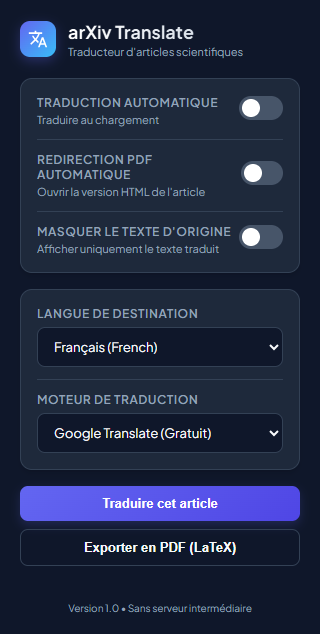
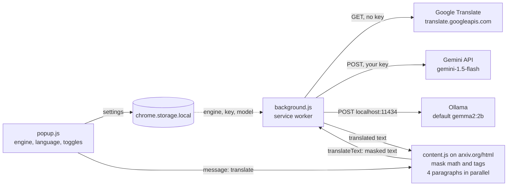

# arXiv Translate: translate arXiv HTML papers without touching the equations

A Manifest V3 Chrome extension that translates arXiv HTML papers paragraph by paragraph into one of 8 languages, with the MathML equations and the page markup kept as arXiv rendered them. Three backends: Google Translate (no key), the Gemini API (your key) or a local Ollama model (offline).



*The popup, captured by [`tools/smoke_test.mjs`](tools/smoke_test.mjs) in Chrome for Testing 156. The interface is in French.*

Personal project, started June 2026.

## How it works



For each paragraph, heading, list item and caption (bibliography, page header and footer skipped), `content.js` works on a copy of the element:

1. Each top-level math node (`<math>`, `.ltx_Math`, MathJax) is replaced by `__MATH_PLACEHOLDER_i__`, then every remaining HTML tag by `__HTML_TAG_PLACEHOLDER_j__`.
2. The masked text goes to `background.js`, which calls the chosen backend. The Gemini and Ollama prompts ask the model to return the placeholders unchanged, at temperature 0.1.
3. The placeholders are swapped back for the original markup, and the result is inserted under the original paragraph (bilingual view). A toggle hides the originals.

```text
in    The loss <math>…</math> is <b>convex</b>.
sent  The loss  __MATH_PLACEHOLDER_0__  is  __HTML_TAG_PLACEHOLDER_0__ convex __HTML_TAG_PLACEHOLDER_1__ .
back  La perte <math>…</math> est<b>convexe</b>.
```

The equation on screen is the one arXiv rendered; it never goes through the translator. (The `back` line is the real output of `restoreElements`: the space before an inline tag is lost, see Limitations.)

On an arXiv PDF the toolbar badge shows `HTML`, and the popup (or an auto-redirect option) opens the HTML version. A print stylesheet hides the arXiv navigation and sets A4 margins and a serif font for printing to PDF.

## Install

Not on the Chrome Web Store yet.

1. Clone this repository.
2. Open `chrome://extensions/`, enable Developer mode, click Load unpacked and select the folder.
3. For Ollama only: pull a model (`ollama pull gemma2:2b`) and start Ollama with `OLLAMA_ORIGINS=chrome-extension://*` set. Without that variable Ollama answers 403 to the extension (seen with Ollama 0.33.3).
4. Open an arXiv HTML paper (`arxiv.org/html/...`), pick an engine and a language in the popup, click Traduire cet article.

## Privacy and API keys

- The paper's text goes only to the backend you pick. There is no server of mine and no analytics; the only network calls are the three in [`background.js`](background.js).
- Google Translate: the masked text goes in the URL of a GET request to an unofficial, keyless endpoint (`client=gtx`).
- Gemini: your key is stored in `chrome.storage.local` on this device (unencrypted, not synced) and sent only to `generativelanguage.googleapis.com`, as the `key` parameter of the request URL.
- Ollama: requests stay on `localhost:11434`.

Full policy: [PRIVACY_POLICY.md](PRIVACY_POLICY.md).

## Tested

[`tools/smoke_test.mjs`](tools/smoke_test.mjs) loads the unpacked extension in headless Chrome for Testing, opens a paper, clicks Translate in the popup and counts the translated paragraphs (`npm install`, then `npm run smoke -- --engine google --paper 2502.00581`).

| Setup | Result |
| --- | --- |
| Chrome for Testing 156, headless, Google backend, arXiv 2502.00581 | Extension loads; of 92 elements, 6 translated and 86 refused by the endpoint (`Failed to fetch`). [Log](docs/smoke_test_2026-11-03.json) |
| Same, Ollama 0.33.3 started without `OLLAMA_ORIGINS` | Every request refused with HTTP 403 |
| Gemini backend | Not tested here (needs a key) |
| Brave, Edge, Opera | Not tested |

The headless run says little about normal use: the free Google endpoint throttles automated traffic.

## Code structure

| File | Role |
| --- | --- |
| [`manifest.json`](manifest.json) | Permissions (`storage`, `activeTab`), hosts, content script on arXiv HTML pages |
| [`content.js`](content.js) | Picks the elements, masks math and tags, runs 4 workers, restores and inserts the translation, progress indicator |
| [`background.js`](background.js) | Service worker: sends each request to Google, Gemini or Ollama; PDF badge and redirect |
| [`popup.html`](popup.html), [`popup.js`](popup.js) | Settings, Translate and Export to PDF buttons |
| [`styles.css`](styles.css) | Bilingual and translation-only views, print stylesheet |
| [`tools/smoke_test.mjs`](tools/smoke_test.mjs) | End-to-end check in Chrome for Testing (Puppeteer) |

## Limitations

- Only papers with an arXiv HTML version work.
- On restore, the spaces around an inline tag (link, bold, citation) are removed, so the word before it sticks to it ("est<b>convexe</b>").
- If a backend drops or rewrites a placeholder, that equation or tag is lost, and a lost tag can leave the paragraph's markup unbalanced. Google gets no instruction about placeholders. I have not tested complex nested LaTeX (multi-line aligned environments, custom macros) systematically.
- The translation is inserted with `innerHTML`, so the extension trusts the HTML the backend returns.
- The Gemini model name is hard-coded (`gemini-1.5-flash` in `background.js`); if Google retires it, that line has to change.
- The popup and status messages are in French.

## License

MIT, see [LICENSE](LICENSE).
